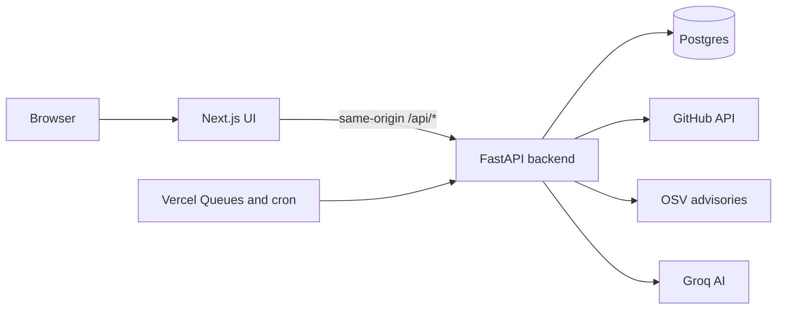

<div align="center">

# Stackwise

### Know which repository needs you next.

An evidence-led maintenance desk for software agencies.<br>
Separate client workspaces, commit-pinned PR reviews, dependency advisories and client-ready reports.

[](https://fintech-codegraph-rag.vercel.app/dashboard?demo=1)
[](https://fintech-codegraph-rag.vercel.app/)


[Features](#-features) · [Demo mode](#-demo-mode) · [Architecture](#-architecture) · [Getting started](#-getting-started) · [Tests](#-running-the-tests) · [Limits](#-boundaries-and-limits) · [Docs](#-documentation)

</div>

---

## At a glance

| 🗂️ **Client workspaces** | 🔍 **Evidence-first reviews** | 🧑⚖️ **Human decisions** |
|:---|:---|:---|
| Every client's code, context and priorities stay separate. | Each finding cites an exact file, line range and commit SHA. | Approve or request changes. Stackwise never edits code or PR state. |

---

## ✨ Features

| | |
|:---|:---|
| **🗂️ Client workspaces**<br>Isolated workspace per client, with GitHub repositories connected to each. Access is checked before any code is retrieved. | **📥 Repository import**<br>Pins the default branch to a SHA and reads supported UTF-8 files without executing code. A failed import keeps the previous snapshot. |
| **🔎 Pull request review**<br>Reads the PR head, diff and related source. Findings are checked against the exact source quote, file, line and SHA. Invalid references are rejected. | **✅ Findings and decisions**<br>Inspect evidence, preview or download diffs, mark useful or false positive, dismiss or resolve, and record a human decision. |
| **📦 Dependency risk**<br>Queries OSV for exact direct npm and PyPI versions. | **📝 Reports**<br>Workspace-scoped weekly Markdown reports: open risks, recent reviews, reported resolutions and next steps. |
| **💬 Ask Your Code**<br>Answers questions about the indexed commit, with source citations. | **🔐 GitHub sign-in**<br>Sign in with GitHub (OAuth App). Each user gets their own workspace; logins in `GITHUB_ADMIN_USERS` see the agency workspaces. |

> [!NOTE]
> Decisions never modify code or GitHub PR state. Zero findings do not approve a review: both review screens show the recorded human decision.

---

## 🎬 Demo mode

Open **[`/dashboard?demo=1`](https://fintech-codegraph-rag.vercel.app/dashboard?demo=1)** for an interactive, clearly labeled sample portfolio. It never touches connected client data, and its decisions are session-local.

> [!IMPORTANT]
> **What is sample content in demo mode**
>
> | Part of the demo | Nature |
> |:---|:---|
> | Code reviews and findings (for example PR #128 in `client-alpha/api-service`) | Authored sample |
> | Ask Your Code answers | Authored sample, not live AI output |
> | Developer activity and Repository issues on Overview | Sample data, labeled "Sample data" |
> | Data when the Python backend is not running | Bundled fallback in `tests/stackwise-demo.json` |

`/dashboard` without `?demo=1` works with real, connected data.

---

## 🏗️ Architecture

One application on Vercel.



| Layer | Technology |
|:---|:---|
| **Frontend** | Next.js, React, TypeScript |
| **Backend** | Python and FastAPI in `api/index.py`, served as `/api/*` |
| **Data** | Managed Postgres through the Vercel Marketplace. No runtime disk persistence |
| **Jobs** | Python Vercel Queues subscriber with runnable-stage fallback. A daily cron creates weekly snapshots and queues repository refreshes |
| **AI** | Groq with a server-side API key. No local model downloads |

---

## 🚀 Getting started

Copy `.env.example` to `.env` and fill in the values. Secrets are server-only and must never be committed. Generate the private settings with `scripts/stackwise_private_settings.py`.

```sh
python -m venv .venv-stackwise
# Activate this environment, then:
python -m pip install -r requirements.txt -r requirements-test.txt -c requirements-vercel.lock
pnpm install --frozen-lockfile
```

Run locally:

```sh
vercel dev        # combined Next.js and Python app
pnpm run dev:ui   # Next.js only
```

> [!NOTE]
> `pnpm run dev:ui` does not start the Python backend. The UI and demo mode work with it, but it does not verify the backend.

Vercel settings, Postgres, environment variables, first sign-in and GitHub webhooks are covered in the [deployment guide](docs/STACKWISE_DEPLOY.md).

---

## 🧪 Running the tests

```sh
python -m pytest -q          # Python backend
pnpm exec vitest run         # UI tests
pnpm lint
pnpm typecheck
pnpm build
```

Stackwise never executes a client's tests. It only reads CI check runs from GitHub.

---

## ⚠️ Boundaries and limits

> [!WARNING]
> Findings are **potential issues** until a human validates them. Source-location validation is not proof that a finding is semantically correct, and a downloadable patch is not a tested fix. Repository text is untrusted data, not agent instructions. Credentials are heuristically redacted before storage and before any AI call; remove sensitive material before importing a repository.

| Limit | Value |
|:---|:---|
| Source per snapshot | 350 supported files, 3 MB, 100 KB per file |
| Pull requests | At most 60 changed files |
| Scale | 20 workspaces, 10 repositories per workspace |
| Languages | Python gets AST symbols; others use lexical text windows |

**Not in this version:** dense embeddings, a test sandbox, a transitive dependency solver, automatic fix branches, autonomous merges, a GitHub App installation flow, billing and SSO. Provider and hosting quotas still apply.

---

## 📚 Documentation

| Guide | Purpose |
|:---|:---|
| [Deployment](docs/STACKWISE_DEPLOY.md) | Vercel, Postgres, environment variables, webhooks |
| [Scope](docs/STACKWISE_SCOPE.md) | Concept mapping and explicit limits |
| [Live verification](docs/STACKWISE_LIVE_VERIFICATION.md) | Observed workflows and remaining coverage limits |
| [Repository layout](docs/REPOSITORY_LAYOUT.md) | Layout and archive of the earlier version |

---

<div align="center">

Stackwise began as **CodeGraph**, a code-retrieval project, and was rebuilt into this agency maintenance desk.<br>
The repository and deployment names still reflect that history. Earlier CodeGraph results remain in Git history and are not a Stackwise benchmark.

</div>
