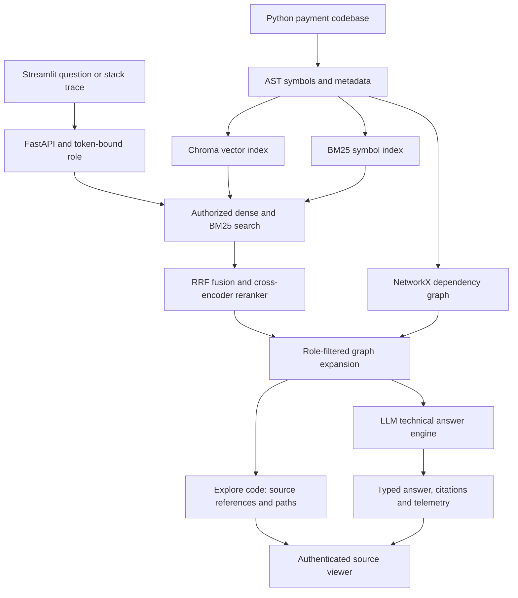

# Historical local workflow

This is the previous laptop/container setup, retained for reference. The active deployment is described in ../README.md and VERCEL.md. These commands are not required for the Vercel deployment.

# Fintech CodeGraph RAG

A local FastAPI and Streamlit application for codebase question answering. It indexes Python symbols, combines dense-vector and BM25 retrieval, reranks candidates, expands an RBAC-filtered NetworkX call graph, and generates citation-grounded answers.

## Requirements and setup

Use Python 3.10 or newer. From the repository root in PowerShell:

```powershell
py -m venv .venv
.\.venv\Scripts\Activate.ps1
python -m pip install --upgrade pip
python -m pip install -r requirements.txt
Copy-Item .env.example .env
```

Set provider credentials in the ignored local `.env` file. Do not commit credentials. `LLM_PROVIDER` supports `openai`, `gemini`, `groq`, and `ollama`; the corresponding SDKs are installed by `requirements.txt`. Ollama also requires its local service and selected model to be available. The embedding and reranker models may need to download on first use.

`ALLOWED_ROLES`, when overridden in the environment, must be a JSON list, for example:

```text
ALLOWED_ROLES=["Junior Dev", "Senior Dev", "Security Lead"]
```

## Index and start

The API loads existing graph, BM25, and vector indices when all are present; otherwise startup indexes `data/sample_codebase`. To build indices explicitly:

```powershell
python scripts/run_indexing.py
```

Start FastAPI from the repository root:

```powershell
python -m uvicorn src.api.main:app --host 127.0.0.1 --port 8000
```

In another terminal, start Streamlit:

```powershell
python -m streamlit run ui/app.py
```

The UI defaults to `http://127.0.0.1:8000`. Set `CODEGRAPH_API_URL` if the API runs elsewhere.

## API

- `POST /query`: accepts `query`, `role`, and optional `stack_trace`; returns an answer, typed status, citations, retrieved items, call paths, per-request token/cost/latency data, and `trace_id`.
- `GET /health`: reports readiness and index/graph counts.
- `GET /metrics`: returns rolling query counts, p50/p95 and average latency, token totals, estimated cost, and cache hit rate.
- `GET /source/{file_path}?role=...`: opens an authorized Python file under the configured sample-codebase directory. It rejects paths outside that directory and enforces the authenticated role's clearance.

### Authentication

`API_ROLE_TOKENS` configures a JSON mapping from Bearer tokens to the supported roles. Production deployments must configure this mapping in both the FastAPI and Streamlit server environments. Use unique secret tokens and never commit real credentials. Example with placeholders only:

```text
API_ROLE_TOKENS={"replace-with-junior-token":"Junior Dev","replace-with-senior-token":"Senior Dev","replace-with-security-lead-token":"Security Lead"}
```

When `API_ROLE_TOKENS` is configured, `POST /query` and `GET /source/{file_path}` require a valid Bearer token. The role bound to that token is authoritative; the `/query` body role and `/source` query-string role are compatibility fields and must match it. Mismatches are rejected rather than elevating access.

The Streamlit server selects the configured token for the selected role and sends it to FastAPI in the `Authorization: Bearer ...` header. The token remains server-side: it is not rendered in the UI, sent to browser JavaScript, or placed in a URL. Citation source is fetched by the Streamlit server using an authenticated request and then displayed in the UI.

For local development only, when no token mapping is configured, the API retains its constrained loopback role-selection fallback. The UI identifies this mode when its API URL is loopback; requests to remote API URLs without role credentials fail with a configuration message. In authenticated deployments, configure exactly one API token for each role selectable in the UI.

## Retrieval, graph, and security

The AST parser extracts functions, classes, methods, imports, decorators, and calls. Symbol chunks feed the dense and BM25 indexes. Both search backends filter by role clearance before returning candidates; hybrid retrieval fuses ranks, reranks candidates, and adds caller/callee context using a role-filtered graph view. Execution paths preserve call-order metadata when available.

Roles and clearances are configured in `src/config.py`: Junior Dev receives public/internal content, Senior Dev also receives confidential content, and Security Lead also receives restricted content. Authorization uses the token-bound role; a supplied request role cannot override it.

## Telemetry

Query metrics and structured traces are held in bounded, process-local memory and reset when the service restarts. Cache keys include normalized query, role, and stack trace; secret-like requests/results are not cached. Traces include retrieval and reranker data, graph paths, prompt context, citations, status, latency, token counts, estimated cost, cache-hit state, and trace ID. Credential-like values and restricted source details are redacted. Health checks do not count as queries. These in-memory stores are not shared across multiple API workers.

## Evaluation and tests

The 40-case dataset is `data/evaluation/gold_dataset.json`. Deterministic retrieval, graph-path, citation, and report utilities are in `src/evaluation/runner.py` and `src/evaluation/metrics.py`. The full retrieval benchmark runs three retrieval modes for all 40 cases and is explicitly invoked with:

```powershell
python -m src.evaluation.run_real_evaluation
```

Answer-quality evaluation is separate and may invoke the configured LLM provider; its module entry point evaluates a five-case smoke subset by default. Do not run either evaluation unless intended.

Pytest redirects graph, BM25, vector and telemetry stores to a disposable
temporary directory before collection. Test authentication starts with an empty
token mapping; individual authentication tests install synthetic tokens.
The host `.env` file and deployed indices are not modified.
Each test overrides the settings object's token mapping so dotenv dictionary
merging cannot retain host credentials. Unless `--basetemp` is supplied explicitly,
pytest also uses a fresh temporary base inside the disposable test folder,
avoiding stale shared pytest temporary-directory permissions on Windows.

Run the offline unit/mocked suite with a 180-second process limit:

```powershell
.\.venv\Scripts\python.exe scripts/run_offline_tests.py
```

This suite includes AST/graph, mocked generation, API/authentication, evaluation
utilities and UI timeout tests. It makes no live LLM requests and does not
initialise embedding or reranker models. It excludes the real neural indexing
and hybrid retrieval modules (`test_phase4_indexing.py`, `test_phase5_hybrid.py`).

Run those real-model tests separately when intended:

```powershell
.\.venv\Scripts\python.exe -m pytest -q tests/test_phase4_indexing.py tests/test_phase5_hybrid.py --durations=10
```

They may download models on first use and take longer on a CPU. Run the full
suite, including these real-model tests, with:

```powershell
.\.venv\Scripts\python.exe -m pytest -q
```

Compile source and tests with:

```powershell
.\.venv\Scripts\python.exe -m compileall src tests
```

## Container workflow and query waits

API container: `fintech-codegraph-api`.
API URL: http://127.0.0.1:8001.
UI URL: http://127.0.0.1:8501.

Preserve the index guard in `scripts/run_test_api.py`, localhost publishing,
read-only host `.env` and launcher mounts, and `codegraph-models-cache`.
Backend source changes require an updated image and container recreation.
Restarting an existing container does not load a newly built image.
UI-only changes do not require a Docker rebuild.

Start the existing stopped API container:

```powershell
docker start fintech-codegraph-api
```

Start Streamlit in a dedicated project PowerShell terminal:

```powershell
Set-Location -LiteralPath 'D:\Personal\fintech-codegraph-rag'
$env:CODEGRAPH_API_URL='http://127.0.0.1:8001'
$env:CODEGRAPH_CONNECT_TIMEOUT='5'
$env:CODEGRAPH_QUERY_READ_TIMEOUT='240'
& .\.venv\Scripts\python.exe -m streamlit run ui/app.py --server.address 127.0.0.1 --server.port 8501 --server.headless true
```

Keep the existing server-side role credentials. Do not replace them with
example tokens. Stop this UI with Ctrl+C in its dedicated terminal.
Stop this API with:

```powershell
docker stop fintech-codegraph-api
```

Do not stop unrelated processes by port.

Configurable network waits:
- `CODEGRAPH_CONNECT_TIMEOUT`: UI connect timeout, default 5 seconds.
- `CODEGRAPH_QUERY_READ_TIMEOUT`: UI read timeout, provisional default 240 seconds.
- `OLLAMA_CONNECT_TIMEOUT`: backend connect timeout, default 5 seconds.
- `OLLAMA_READ_TIMEOUT`: backend read timeout, provisional default 180 seconds.

UI variables come from the Streamlit process environment. Ollama variables
come from backend settings, including the mounted `.env`. Restart the
affected service after configuration changes. Values must be positive
finite numbers.

Read timeouts limit waiting for network data, not guaranteed total query
duration. The UI setting leaves headroom for retrieval. Verify provisional
settings against measured uncached requests.

A client timeout does not prove backend work completed or stopped.
Check correlated logs before another submission. Query requests are not
automatically retried. Health alone does not establish query completion.


## Timeout verification outcome (2026-10-10)

Two uncached Senior Dev requests through the UI client returned HTTP 200 in 84.09 s and 66.07 s, with INSUFFICIENT_EVIDENCE, eight citations and successful authenticated fetches of six unique source files. The second request spent 7.88 s in retrieval and 58.11 s in the Ollama provider call. Health checks still timed out during both requests (7/13 and 4/10); their cause remains unresolved. Browser visual verification is pending. The normal test suite was incomplete after 180 s; focused tests, graph tests and compile checks passed. Temporary launcher diagnostics were removed and the original launcher was restored before restarting the API.


## Explore code

The Streamlit UI defaults to **Explore code**: find role-authorized source references,
retrieval provenance and execution paths, then use **Open source** to inspect a file.
Select **Generate answer** to use the existing LLM-backed analysis flow. Changing
the API address, role or mode clears the previous result and opened source.

`POST /retrieve` accepts the same question, optional stack trace and role fields as
`POST /query`. It uses the same token-bound authorization and hybrid graph pipeline,
and returns `sources`, `retrieved_items`, `call_path`, `role`, `query` and `latency_ms`.
Retrieval runs in a worker thread. It does not call the generator, classify an answer,
or add to generated-query metrics, traces or the answer cache. Source references are
retrieved matches, not proof of a generated claim. Unknown or unauthorized path
nodes fail closed. The existing authenticated `/source` endpoint opens source files.

`CODEGRAPH_RETRIEVAL_READ_TIMEOUT` controls the UI retrieval read wait (default 60
seconds); connect wait still uses `CODEGRAPH_CONNECT_TIMEOUT`. There are no automatic
retries. A timeout does not establish that backend retrieval stopped.

This feature requires an updated API image and container recreation, preserving the
index guard, existing indices, credentials, localhost publishing and model cache.
Restart the project UI after deployment. A UI pointed at an older API displays an
update message when Explore code receives HTTP 404.

Offline verification includes mocked authenticated API requests and Streamlit AppTest
reruns for Explore, source opening, scope changes, and the existing answer mode:

```powershell
& .\.venv\Scripts\python.exe scripts/run_offline_tests.py
```

These checks do not load embedding models, submit live generation, or establish
production CPU responsiveness. The earlier generation-time health delays remain
unresolved.


## Project 10 architecture

This implements Edversity Project 10, Cursor-Style Fintech Codebase Graph RAG,
using a synthetic Pakistani payment-integration codebase (JazzCash, 1LINK and
EasyPaisa examples). The sample keys and source-authority label are demonstration
fixtures, not real provider credentials or an assertion of SBP approval.



The generator supports configured Ollama, OpenAI, Gemini or Groq providers.
The current generator profile uses Groq-hosted `openai/gpt-oss-120b`. Dense embeddings
use BGE; lexical matching uses BM25; a cross-encoder reranks fused candidates.
Graph traversal preserves available call-order metadata and filters paths by role.

### Assignment evidence and limits

The gold dataset contains 40 questions with expected symbol document IDs, source
files, execution paths and answer facts. Symbol document IDs are the stable citation
references; numbered citation labels depend on each request's context ordering.
Historical retrieval metrics are in `data/evaluation/real_report.md`. The successful
2026-10-10 four-combination JazzCash demo achieved full expected-symbol context
coverage after graph expansion for both authorized role sets. It is a one-question
demo, not a newly completed 40-case benchmark or proof of generated-answer correctness.

The evaluation utilities include code-symbol precision, call-path recall, execution
path accuracy and a gold file/symbol citation-match proxy. The stored historical
citation score is zero; source-link accessibility does not establish claim grounding.
Answer-quality proxy scoring in `src/evaluation/llm_evaluation.py` is not a verified
Ragas/DeepEval judge run. Its optional legacy DeepEval branch maps answer relevancy
to answer correctness; that branch must not be cited as a valid correctness benchmark.
A separate Q01 DeepEval 4.2.8 diagnostic completed on 2026-10-11 using
the local `llama3.2:3b` judge: Faithfulness 1.0000, Answer Relevancy 0.3333,
and Reference Correctness 0.6000 (threshold 0.70).
Faithfulness uses a custom extraction prompt and schema capped at 20 facts
**total** across the unchanged retrieved context. It is a limited-evidence
single-case diagnostic; the earlier per-document extraction failed from
timeouts/output truncation. Only Faithfulness passed. The local judge has
not been human validated; this does not establish complete answer
correctness or a newly completed 40-question benchmark. Metric evidence:
[Q01 diagnostic](data/evaluation/q01_deepeval_diagnostic.json).
No model-based hallucination score is claimed.

Chroma applies role clearance inside its query. BM25 returns only authorized
candidates but retains a shared server-side corpus in memory; physical per-role
corpus isolation is not implemented. Telemetry and cache are bounded process-local
stores. Generation-time health delays on the CPU laptop remain unresolved.

Public GitHub publication and the required 2-3 minute video are submission actions
to complete separately. See `docs/PROJECT10_REQUIREMENTS.md` and
`docs/VIDEO_SCRIPT.md` for the requirement mapping and recording sequence.


## Temporary online demonstration

The existing Windows demo can be shared through a temporary Cloudflare Quick
Tunnel pointing at the running Streamlit UI. Set `CODEGRAPH_PUBLIC_DEMO=1` when
launching the public UI: its API address then comes exclusively from the server's
`CODEGRAPH_API_URL`, and visitors cannot edit the request destination.
This prevents server-side role tokens from being sent to a visitor-chosen API host.
The role selector demonstrates permissions over synthetic sample code; it is not
a production login system. Use this sharing workflow only for this sample-code demo.

`share_online_demo.py` in the delivery bundle verifies the existing API, applies
the UI-only patch, restarts only an ownership-verified project UI, and downloads
the official Windows Cloudflare executable into a fresh ignored telemetry folder.
It prints a real temporary HTTPS URL without publishing API port 8001 or Ollama.
The laptop, API, UI and tunnel process must remain running for sharing; Groq
generation also requires internet access and a valid server-side API key. Ctrl+C stops only the tunnel this helper started.

A GitHub repository stores source; GitHub Pages cannot run this Python API/UI stack.
Permanent independent hosting needs a server/container environment for FastAPI,
Streamlit, indices/models, and an accessible LLM provider. A cloud-hosted UI cannot
reach your laptop's `127.0.0.1:8001` address. See `docs/ONLINE_DEMO.md` for the
sharing commands and the limitations of the temporary URL.

## Groq cloud generation

The Windows demo can use Groq to move LLM inference off the laptop. Code parsing,
embeddings, reranking and graph retrieval still run locally. The integration uses
a fixed official HTTPS endpoint, a 5-second connect wait, a 90-second provider
read wait, no automatic retry, and a 2048-token completion budget. Length-cut
answers are rejected in favor of the conservative evidence assessment.

API credentials belong only in the ignored local .env. Questions and retrieved
code snippets are sent to Groq; the demonstration corpus is synthetic. Free-plan
quotas can reject requests with HTTP 429. Estimated cost uses published model
list prices and is not an invoice or evidence of paid/free account status.
See [Groq setup](docs/GROQ_SETUP.md). The historical Ollama Q01 diagnostic is
retained; it does not evaluate the new Groq generator.

## Documented facts and answer grounding

Organizational headings and the evidence-status label are excluded from factual
claim checks; the content under them still requires valid supporting citations.
Numeric values and duration units must occur in the cited source. Grounding
remains a conservative lexical heuristic, not a model-based correctness score.

For simple documented-latency questions, a rejected generated explanation can
fall back to an exact relevant docstring quotation from the authorized retrieved
context. Conflicting quoted ranges and causal or measured-performance questions
retain the cautious fallback. No gold-dataset answer is used for this extraction.
The generic fallback describes validation uncertainty about the actual question
instead of asserting an unrelated timeout or database root cause. One cited
source can support a complete documented fact with an explicit Supported label.
